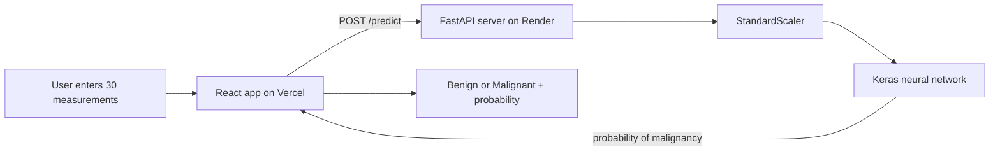

# Breast Cancer Classifier

A deep learning web app that estimates whether a breast tumor is **benign** or **malignant** from 30 numeric measurements of cell nuclei taken from a fine-needle biopsy image.

**Live demo:** https://frontend-one-lake-27.vercel.app/

> **Educational project only.** This is a learning exercise. It is not a medical device, has not been clinically validated, and must never be used to diagnose or make decisions about anyone's health. Talk to a doctor about any health concern.

<!-- Add a screenshot of the app here, for example:

-->

## Features

- Neural network classifier trained on the Breast Cancer Wisconsin (Diagnostic) dataset
- Clean React interface with the 30 inputs grouped into three tabs (Mean, Standard error, Worst)
- One-click benign and malignant example rows so you can try it straight away
- Paste all 30 values at once, with validation and friendly error messages
- Warns when an entered value is outside the range the model was trained on
- Result shown as a probability, with a scale from benign to malignant
- Works on desktop and mobile, and respects reduced-motion settings

## How it works



1. The React app checks the inputs and sends the 30 numbers to the API.
2. The FastAPI server scales them with the same `StandardScaler` that was fitted on the training data.
3. The trained Keras model returns the probability that the tumor is malignant.
4. The app shows the label (probability of 0.5 or more is malignant) and a probability scale.

## Dataset

[Breast Cancer Wisconsin (Diagnostic)](https://archive.ics.uci.edu/dataset/17/breast+cancer+wisconsin+diagnostic) from the UCI Machine Learning Repository.

| | |
|---|---|
| Samples | 569 (357 benign, 212 malignant) |
| Features | 30 numeric |
| Target | `diagnosis`: B = benign (0), M = malignant (1) |

Ten measurements are computed for each cell nucleus: radius, texture, perimeter, area, smoothness, compactness, concavity, concave points, symmetry and fractal dimension. Each one is given as the **mean**, the **standard error** and the **worst** value, which gives 30 features.

## Model

A multilayer perceptron (MLP) built with TensorFlow / Keras.

```
Input (30)
  -> Dense(64, ReLU) -> BatchNormalization -> Dropout(0.4)
  -> Dense(32, ReLU) -> BatchNormalization -> Dropout(0.4)
  -> Dense(1, Sigmoid)
```

**Training setup**

- Stratified split: 70% train, 15% validation, 15% test
- `StandardScaler` fitted on the training data only, to avoid data leakage
- Class weights to handle the mild class imbalance (about 63% benign, 37% malignant)
- Adam optimizer, binary cross-entropy loss, batch size 32
- Callbacks: EarlyStopping, ReduceLROnPlateau and ModelCheckpoint
- Grid search over 12 combinations of layer sizes, dropout and learning rate. The best was 64/32 units, dropout 0.4, learning rate 0.001

**Results on the held-out test set (86 samples: 54 benign, 32 malignant)**

| Accuracy | Precision | Recall | Specificity | F1-score | ROC-AUC |
|---|---|---|---|---|---|
| 1.00 | 1.00 | 1.00 | 1.00 | 1.00 | 1.00 |

No test sample was misclassified. Please read this carefully: the test set is small, and a perfect score on 86 samples is probably optimistic. Expect a little lower on new data. Cross-validation and external validation would give a more honest estimate.

## Project structure

```
Breast-Cancer-classifier/
├── backend/             FastAPI server and the trained model
│   ├── main.py          API: /, /health, /predict
│   ├── Dockerfile
│   ├── requirements.txt
│   ├── breast_cancer_model.keras
│   ├── scaler.pkl
│   └── feature_names.json
├── frontend/            React + Vite app
│   ├── src/             App.jsx, App.css, main.jsx
│   └── public/
├── env.example          Example environment variable for the frontend
├── render.yaml          Render deployment settings for the backend
└── .gitignore
```

## Run it locally

You need **Node.js** (LTS) and **Python 3.10 to 3.12**.

### 1. Start the API

```bash
cd backend
python -m venv .venv
# Windows:  .venv\Scripts\activate
# macOS/Linux:  source .venv/bin/activate
pip install -r requirements.txt
uvicorn main:app --reload
```

The API runs at `http://127.0.0.1:8000`. Interactive docs are at `http://127.0.0.1:8000/docs`.

### 2. Start the web app

In a second terminal:

```bash
cd frontend
npm install
```

Create a file named `.env` inside `frontend/` (copy it from `env.example`) with:

```
VITE_API_URL=http://127.0.0.1:8000
```

Then run:

```bash
npm run dev
```

Open the address shown in the terminal (usually `http://localhost:5173`).

## API

### `GET /health`

Returns `{"status": "ok"}` when the server is running.

### `POST /predict`

Send the 30 feature values as a list, in this order: the 10 `_mean` values, then the 10 `_se` values, then the 10 `_worst` values (the same order as `feature_names.json`).

```bash
curl -X POST http://127.0.0.1:8000/predict \
  -H "Content-Type: application/json" \
  -d '{"features": [17.99, 10.38, 122.8, 1001.0, 0.1184, 0.2776, 0.3001, 0.1471, 0.2419, 0.07871,
                    1.095, 0.9053, 8.589, 153.4, 0.006399, 0.04904, 0.05373, 0.01587, 0.03003, 0.006193,
                    25.38, 17.33, 184.6, 2019.0, 0.1622, 0.6656, 0.7119, 0.2654, 0.4601, 0.1189]}'
```

Response shape:

```json
{ "label": "Malignant", "probability": 0.98 }
```

`probability` is the model's estimated probability that the tumor is malignant. A request with the wrong number of values returns a `422` error with a clear message.

## Deployment

| Part | Platform | Notes |
|---|---|---|
| Frontend | [Vercel](https://vercel.com) | Set the root directory to `frontend` and add `VITE_API_URL` pointing to the deployed API |
| Backend | [Render](https://render.com) | Docker web service using `render.yaml` (root directory `backend`, free plan) |

On free hosting the server may go to sleep when idle, so the first prediction after a quiet period can take up to a minute. The app shows a message if this happens.

`ALLOWED_ORIGINS` (set in `render.yaml`) controls which websites may call the API. It is `*` for the demo. For anything beyond a demo, set it to your frontend's address.

## Tech stack

- **Model:** Python, TensorFlow / Keras, scikit-learn, pandas, NumPy
- **API:** FastAPI, Uvicorn, Docker
- **Frontend:** React, Vite, plain CSS
- **Hosting:** Vercel (frontend), Render (backend)

## Limitations

- Trained on 569 samples from a single dataset, so it may not work on data from other hospitals or equipment.
- It takes already-computed measurements as input. It does not read images.
- The test set is small, so the reported scores are optimistic.
- Probabilities are not clinically calibrated.

## Ideas for the future

- 5-fold cross-validation and external validation
- Model explanations (for example SHAP) shown in the app
- Upload a biopsy image and extract the features automatically
- Compare against other models (logistic regression, random forest, gradient boosting)

## Acknowledgements

Dataset: W. H. Wolberg, W. N. Street and O. L. Mangasarian, *Breast Cancer Wisconsin (Diagnostic)*, UCI Machine Learning Repository.

## Author

Built by [Zeeshan608](https://github.com/Zeeshan608).
